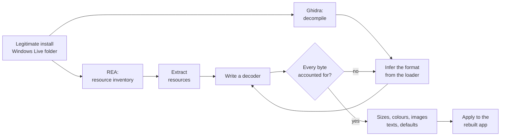

# Windows Live Mail 2012: reverse-engineering notes

[日本語](README.md) | English

These are notes on reverse engineering **Windows Live Mail 2012 (Japanese edition)**, which reached end of support in 2017. All work was done on a legitimately owned installation. The repository holds the write-up of the method and the tools written for it.

> Keep the look and the behaviour exactly as they were; rebuild everything underneath with current components.

To get there, the screen dimensions, colours, images, ribbon layout, keyboard shortcuts, and even the reply subject prefix and quote format were read out of the program and its resources.

## Why

A family member had used Windows Live Mail 2012 every day for more than ten years. Years after the end of support, it was no longer safe to keep using it. But a new mail client moves every button and changes every screen.

So the plan was a mail client that **looks and behaves like the original down to the detail, with modern internals**. "Roughly similar" was not enough: row heights, the colour of a selected row, whether the reply prefix is "RE:" or "Re: ". Instead of imitating the screen by eye, every value was taken from the original files.

The rebuilt app runs only on the family PC. It contains Microsoft's images and strings, so it is not distributed.

## Findings

| Area | What was found | Chapter |
|---|---|---|
| Screen layout | The "UIB" resources in `mailres2.dll` are **code for a small stack-based virtual machine** that builds the element tree. About 40 opcodes and 7 sections were decoded; all 29 files decode to the last byte | [2](docs/02-ui-layout-uib.md) |
| Visual states | Selected, hover and inactive appearances come from **conditional rule sheets**, similar to CSS. Row states are bit flags | [2](docs/02-ui-layout-uib.md) |
| Images | 514 images use a **custom RLE compression**: nine-grid parts, 5-bit and 8-bit channels, and a hue-only "colorize" form. All pass a self-check | [3](docs/03-resources.md) |
| Colour schemes | The 12 colour schemes combine the hue of the chosen colour with stored saturation and lightness. The calculation is reproduced step by step | [3](docs/03-resources.md) |
| Ribbon | The undocumented compiled ribbon markup (`SCBin`) was decoded from its bytes: 245 commands, labels, key tips, and per-feature visibility bits | [4](docs/04-ribbon-and-strings.md) |
| Shortcuts | Nine accelerator tables, one per window type. Ctrl+Enter means "mark as read" in the message list but "send" in the compose window | [4](docs/04-ribbon-and-strings.md) |
| Read / unread | Not stored in the `.eml` files. In the store `Mail.MSMessageStore` (an **ESE database**), bit **0x80** of `MSGCOL_FLAGS` means read. Checked against the unread counter of every folder | [5](docs/05-message-store.md) |
| Behaviour | Much of the behaviour (the "Re: " prefix, no `>` quote marks, replying in the original format) is switched by an **options default table** inside `msmail.dll` | [6](docs/06-behavior.md) |
| Reply quote | An HTML reply gets a grey (#F5F5F5) header box with English labels. "-----Original Message-----" appears only in plain-text replies | [6](docs/06-behavior.md) |

## Method



1. **Inventory**: list resource types, locations and SHA-256 with REA.
2. **Read the loader**: when a format is undocumented, decompile the function that loads it (for example `FUN_100c074a` in `uxcore.dll`) and work back to the format.
3. **Check with a decoder**: write a decoder from the inferred rules and require that every resource decodes to the last byte without contradiction. If not, go back to step 2.
4. **Apply**: use the extracted values unchanged in the rebuilt app.

AI agents (Claude Code) did much of the legwork. Separate agents worked in parallel on the layout format, colours and images, the ribbon, the options dialogs and the behaviour inventory.

## Chapters (Japanese)

| Chapter | Contents |
|---|---|
| [1. Environment](docs/01-environment.md) | Running REA and Ghidra on Linux to analyse Windows DLLs |
| [2. Layout format (UIB)](docs/02-ui-layout-uib.md) | Decoding the compiled screen definitions from their loader |
| [3. Colours, images, margins](docs/03-resources.md) | Custom RLE images, nine-grid frames, colour schemes, theme overlays |
| [4. Ribbon, shortcuts, strings](docs/04-ribbon-and-strings.md) | Compiled ribbon, accelerator tables, strings, menus and dialogs |
| [5. Message store](docs/05-message-store.md) | Reading read/unread state from the ESE database |
| [6. Reading behaviour](docs/06-behavior.md) | Reply prefix and quote format from strings, code and the defaults table |
| [7. Rebuild](docs/07-rebuild.md) | Same values as the layout files; MailKit and WebView2 inside; unavailable features kept but greyed out |
| [8. Open questions](docs/08-unknowns.md) | What is still inferred, and how to check it |

Detailed specifications in English:

- [spec/uib-format.md](spec/uib-format.md): the UIB format (header, sections, every opcode, values, layouts, sheets)
- [spec/resources.md](spec/resources.md): resource types 4000–4012 (colours, images, RLE, margins, sprites, colorize)

## In numbers

| Item | Count |
|---|---|
| Layout files (UIB) | 29, all fully decoded |
| Images (`mailres2.dll`) | 1,159 (587 PNG, 514 RLE, others) |
| Colours | 251 (not counting theme overlays) |
| Japanese strings | 4,265 |
| Dialogs / menus | 188 / 35 |
| Ribbons | 8, with 245 commands |
| Accelerator tables | 9 |
| Behaviours inventoried | about 110 |

## Using the tools

The tools are Python 3 and need only the standard library, except the ESE reader.

```bash
git clone https://github.com/hinatamaxxx/wlm2012-research.git
cd wlm2012-research

# Copy your own installation (C:\Program Files (x86)\Windows Live) to targets/Windows Live/.
# It is not part of this repository.
mkdir -p targets && cp -r "/path/to/Windows Live" "targets/Windows Live"

# Extract the layout files and turn them into XML (needs REA)
rea inspect-pe-resources "targets/Windows Live/Mail/mailres2.dll" --format json > mailres2.resources.json
python3 -I tools/tools-res.py extract mailres2.resources.json 4010 extract/4010
python3 -I tools/uib/uib2xml.py --check extract/4010/7001_1033.bin
python3 -I tools/uib/uib2xml.py extract/4010/7001_1033.bin -o xml/7001.xml

# Export colours and images (no REA needed)
python3 -I tools/resources/decode_resources.py out/
```

The tool list is in [tools/README.md](tools/README.md) (Japanese). The output (XML, images, string tables) contains Microsoft's copyrighted material; do not publish it.

## Conventions

The chapters keep observations and inferences apart:

- **[観察] observed**: read directly from code or data in the binaries, with the function address.
- **[推定] inferred**: concluded from data layout, naming or consistency.

Addresses use Ghidra's names (such as `FUN_100c1c0c`) at each DLL's image base. Nothing was checked by running the original side by side; the evidence is static analysis plus checks against real data (the message store).

## Notice

- This is a personal research record and is not affiliated with Microsoft.
- Windows Live, Windows and Microsoft are trademarks of Microsoft Corporation.
- The repository contains no Microsoft programs, images, copies of string tables or copies of decompiled code. Only short strings (such as the "Re: " prefix) and function addresses are quoted for explanation.
- Only an installation owned by the author was analysed.

## License

The tools and documents written for this repository are under the [MIT License](LICENSE). Windows Live Mail and Microsoft's files, images and strings are not covered.
