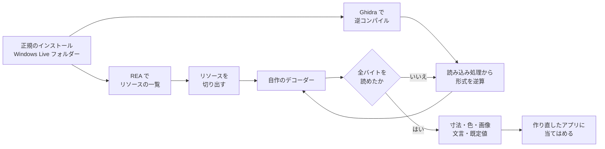

# Windows Live メール 2012 の解析ノート

日本語 | [English](README.en.md)

2017 年にサポートが終わった **Windows Live メール 2012（日本語版）** を、手元にある正規のインストール済みファイルからリバースエンジニアリングした記録です。調べ方の解説と、そのために書いた自作の道具を置いています。

> 見た目と動きはそのまま、中身は今の部品で作り直す。

そのために、画面の寸法・色・画像、リボンの並び、キー操作、返信の件名や引用の形までを、プログラムとリソースから読み取りました。

## はじまり

家族が十年以上、毎日使ってきたメールソフトが Windows Live メール 2012 でした。サポートが終わって何年も経ち、セキュリティの面でも使い続けるのは心配です。とはいえ、新しいメールソフトに替えると、ボタンの場所も画面の見た目も変わってしまいます。

そこで、**本物と見分けがつかない見た目と動きのまま、中身だけを今の部品にしたメールソフト**を作ることにしました。「だいたい似ている」では足りません。行の高さ、選んだ行の色、件名の頭が「RE:」か「Re: 」か、といった細部まで本物に合わせるために、目で見て真似るのではなく、本物のファイルから値を読み取る方法を取りました。

作り直したアプリは家族の PC だけで使っています。Microsoft の画像や文字列を含むので、配布はしていません。

## わかったこと

| 対象 | わかったこと | 章 |
|---|---|---|
| 画面の設計図 | `mailres2.dll` の "UIB" は、画面の木を組み立てる**スタック型の仮想機械のコード**だった。約 40 の命令と 7 つの区画を読み解き、29 ファイルすべてを最後のバイトまで読めた | [2](docs/02-ui-layout-uib.md) |
| 状態ごとの見た目 | 選択中・マウスが乗っている・非アクティブなどの見た目は、CSS に似た**条件付きの規則（シート）**で決まる。行の状態はビットの組で表される | [2](docs/02-ui-layout-uib.md) |
| 画像 | 514 個の画像が独自の **RLE 圧縮**だった。9 分割の枠、5 ビットと 8 ビットの色、配色に合わせて色相だけ変える形式まで解読し、全部が自己検査を通った | [3](docs/03-resources.md) |
| 配色 | 12 色の配色は「選んだ色の色相 + 保存された彩度と明るさ」で計算する。計算を本物と同じ手順で再現した | [3](docs/03-resources.md) |
| リボン | 公開されていないコンパイル済みのリボン定義（`SCBin`）を、バイト列から読み解いた。245 のコマンド、ラベル、キーヒント、表示する機能のビット | [4](docs/04-ribbon-and-strings.md) |
| キー操作 | 窓ごとに 9 つのアクセラレーター表。同じ Ctrl+Enter が、一覧では「開封済みにする」、作成の窓では「送信」 | [4](docs/04-ribbon-and-strings.md) |
| 既読・未読 | `.eml` には書かれていない。保存庫 `Mail.MSMessageStore`（**ESE データベース**）の `MSGCOL_FLAGS` の **0x80** が既読。全フォルダーの未読数と照合して確かめた | [5](docs/05-message-store.md) |
| 動き | 返信の頭「Re: 」、引用に `>` を付けない、受け取った形式で返信する、といった動きの多くは、`msmail.dll` の中の**オプションの既定値表**で切り替わる作りだった | [6](docs/06-behavior.md) |
| 返信の引用 | HTML の返信は灰色（#F5F5F5）の囲みに英語のヘッダー。「-----Original Message-----」はテキストの返信にだけ付く | [6](docs/06-behavior.md) |

## 解析の流れ



1. **一覧を取る**: REA でリソースの種類・位置・SHA-256 を一覧にする。
2. **読み込む側を読む**: 形式が公開されていないものは、それを読み込む関数（例: `uxcore.dll` の `FUN_100c074a`）を Ghidra で逆コンパイルして、形式を逆算する。
3. **デコーダーで確かめる**: 読み取った規則でデコーダーを書き、手元のすべてのリソースが最後のバイトまで矛盾なく読めることを確かめる。読めなければ 2 に戻る。
4. **当てはめる**: 取り出した値を、作り直したアプリにそのまま使う。

途中の作業には AI エージェント（Claude Code）を使いました。画面の設計図、色と画像、リボン、オプション画面、動きの洗い出しを、分野ごとに別のエージェントに並行して担当させています。

## 読みもの

| 章 | 内容 |
|---|---|
| [1. 解析の環境](docs/01-environment.md) | REA・Ghidra を Linux に入れて、Windows の DLL を調べられるようにする |
| [2. 画面の設計図（UIB）](docs/02-ui-layout-uib.md) | コンパイル済みの画面定義を、読み込み処理から逆算して全部読む |
| [3. 色・画像・余白](docs/03-resources.md) | 独自の RLE 画像、9 分割の枠、配色の計算、テーマの上書き |
| [4. リボン・キー操作・文字列](docs/04-ribbon-and-strings.md) | コンパイル済みのリボン、アクセラレーター表、文字列・メニュー・ダイアログ |
| [5. メールの保存庫](docs/05-message-store.md) | ESE データベースから既読・未読を読む |
| [6. 動きを読み取る](docs/06-behavior.md) | 文字列・コード・既定値表から、返信の件名や引用の形を突き止める |
| [7. 作り直しの方針](docs/07-rebuild.md) | 見た目は設計図の数字どおり、中身は MailKit と WebView2、使えない機能は灰色で残す |
| [8. わかっていないこと](docs/08-unknowns.md) | 推定のまま残っているもの、確かめ方 |

詳しい仕様（英語）:

- [spec/uib-format.md](spec/uib-format.md): UIB 形式（ヘッダー、区画、全命令の表、値・レイアウト・シートの組み立て）
- [spec/resources.md](spec/resources.md): 種類 4000〜4012 のリソース（色、画像、RLE、余白、スプライト、配色）

## 数字で見る

| 項目 | 数 |
|---|---|
| 画面の設計図（UIB） | 29 ファイル、すべて完全に読めた |
| 画像（`mailres2.dll`） | 1,159 個（PNG 587、RLE 514、その他） |
| 色 | 251 個（テーマの上書きを除く） |
| 日本語の文字列 | 4,265 件 |
| ダイアログ / メニュー | 188 個 / 35 個 |
| リボン | 8 種類、コマンド 245 件 |
| アクセラレーター表 | 9 個 |
| 洗い出した動き | 約 110 項目 |

## 道具を使う

道具は Python 3 で書いています。ESE の読み取りを除き、標準ライブラリだけで動きます。

```bash
git clone https://github.com/hinatamaxxx/wlm2012-research.git
cd wlm2012-research

# 解析する対象（手元の正規のインストールの C:\Program Files (x86)\Windows Live）を
# targets/Windows Live/ に写す。リポジトリには含まない
mkdir -p targets && cp -r "/path/to/Windows Live" "targets/Windows Live"

# 画面の設計図を取り出して XML にする（REA が必要）
rea inspect-pe-resources "targets/Windows Live/Mail/mailres2.dll" --format json > mailres2.resources.json
python3 -I tools/tools-res.py extract mailres2.resources.json 4010 extract/4010
python3 -I tools/uib/uib2xml.py --check extract/4010/7001_1033.bin
python3 -I tools/uib/uib2xml.py extract/4010/7001_1033.bin -o xml/7001.xml

# 色と画像を書き出す（REA は不要）
python3 -I tools/resources/decode_resources.py out/
```

道具の一覧は [tools/README.md](tools/README.md) にあります。書き出したもの（XML、画像、文字列表）は Microsoft の著作物を含むので、公開しないでください。

## 書き方の約束

各章では、確かめたものと推し量ったものを分けています。

- **[観察]**: バイナリのコードやデータから直接読んだもの。関数の番地を付けています。
- **[推定]**: データの並びや名前、つじつまから推し量ったもの。

番地は Ghidra が付ける名前（`FUN_100c1c0c` など）で、各 DLL のイメージ基準の番地です。本物を実際に動かして見比べた確認はしていません。静的な解析と、実データ（保存庫）の照合だけです。

## 注意

- これは個人の研究記録です。Microsoft とは関係がありません。
- Windows Live、Windows、Microsoft は Microsoft Corporation の商標です。
- このリポジトリには、Microsoft のプログラム、画像、文字列表の写し、逆コンパイルしたコードの写しは含めていません。説明のために、短い文字列（例: 件名の頭「Re: 」）や関数の番地を挙げているだけです。
- 解析には、自分が正規に持っているインストールだけを使いました。

## ライセンス

自作の道具と文書は [MIT ライセンス](LICENSE) です。Windows Live メールと、Microsoft のファイル・画像・文字列は対象外です。
